# dsh-ontology

[](https://github.com/Ding-6/dsh-ontology/actions/workflows/ci.yml)
[](https://www.npmjs.com/package/@ding-6/dsh-ontology)
[](https://www.npmjs.com/package/@ding-6/dsh-ontology)
[](LICENSE)


给开发本体应用用的「本体建模工作空间」：一个常驻的 DSH 插件，把**统一语义层 + 看板 + 角色 agent + 内部市场**装进 DSH Web 的同一个页面里。
它不预置任何行业数据，模型只留与行业无关的建模原语：
数据层的业务对象 / 属性 / 对象关系 / 术语方案 / 对象实例，逻辑层的业务规则 / 校验形状，行动层的可调用行动 / 应用场景，再加一本平台操作手册库；
多个本体可以并存（民用、商用、军用各建各的），AI 自动生成约 80%，专家审核校准约 20%；
对外按对象 / 关系 / 规则 / 行动四类封装成通用 MCP 工具或专有本体 SDK。
它同时是**本体应用开发副驾**：帮你做业务分析、推荐对象与规则建模、给出数据模型 / 规则引擎 / API 契约 / 前端设计 / 本体驱动 / 测试方案六章蓝图；
插件**随包内置《智元·本体智能体平台操作手册 V2.0》（86 个章节）**，一键载入手册库后，专家用 `ontology_guide_search` 检索并照手册教你操作；你自己的平台手册也能存进同一本手册库。
语义层里躺着三类本体资产——业务对象 / 对象关系（数据层）、业务规则（逻辑层）、可调用行动（行动层）；
agent 负责 AI 自动生成约 80%，专家审核校准约 20%；对外再按对象 / 关系 / 规则 / 行动四类封装成通用 MCP 工具或专有本体 SDK。
自建 GitLab 管代码、飞书管交流，agent 负责业务 / 架构 / 建模 / 校验四个角色的具体活儿。

运行环境：DSH `0.2.1-rc.5`，Node 22 以上，Linux/macOS（Windows 原生不支持 `link:` 安装 + systemd 托管）。

维护：供应链数字化组。有问题在本仓库开 issue，或直接找看板里的「产品」；发版流程见 [docs/publish.md](docs/publish.md)。

## 功能地图

按「一条需求从生到死」的顺序排，细节见各专题文档；实现流水账在 [docs/history.md](docs/history.md)。

| 阶段 | 能力 |
| --- | --- |
| 语义层 | 八类资产的统一台账（对象 / 关系 / 规则 / 行动 / 术语方案 / 对象实例 / 校验形状 / 应用场景）；多本体并存；AI 草稿 → 专家校准；缺口检查（无属性对象、悬挂关系、无表达式规则、无目标行动）；建模建议器点出阻塞项；按对象 / 关系 / 规则 / 行动四类封装成通用 MCP 工具或专有本体 SDK |
| 场景 | 统一编号、功能点拆解、可追溯矩阵、待确认清单、RICE 需求池、变更历史 |
| 澄清 | 拆卡前的必答项与门禁（`src/host/discovery.js`），答不全不许开工 |
| 设计 | 语义设计评审记录 + 进开发前的闸门（`src/host/design.js`） |
| 蓝图 | **应用蓝图六章**：数据模型 / 规则引擎 / 后端与 API 契约 / 前端设计 / 本体怎么驱动应用 / 测试方案，从语义层直接生成 |
| 骨架 | 八套**领域骨架模板**（通用 / 工业 / 安全 / 医疗 / 国防 / 地理 / 金融 / 知识），只给结构不给行业数据 |
| 执行 | 一卡一会话、一卡一 worktree；自动派单给业务/架构/建模/校验四类专家 |
| 校验 | 接口 / shell / 数据库三种执行器；跨卡用例总览；失败自动开缺陷卡 |
| 准出 | 卡片与需求两级准出、验收清单、覆盖矩阵、人工签字 |
| 发布 | 版本 tag、灰度与部署记录、冒烟清单、发布门禁 |
| 观测 | 工作台（在办/逾期/阻塞/缺陷）、效能（周期分布/返工/AI 成本）、燃尽 |
| 集成 | GitLab（MR 事实对账）、飞书（云文档/多维表格/webhook）、内部市场 |

## 界面与组件

前端是单文件产物 `client.js`，界面组件统一走 **BoardUI** 的官方源码（MIT，原样引入，见 `web/src/components/base/**`），
自有样式只在 `web/src/index.css` 与 `web/src/boardui/**` 两处补位。

- 组件清单与取舍理由：[docs/ui.md](docs/ui.md)
- 本地打过补丁的 vendored 文件只有两处（`notification.tsx` / `toast.tsx` 的 `container`），清单同样在 `docs/ui.md`

## 它是怎么跑的

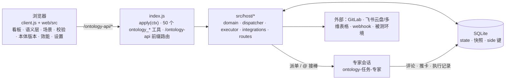

一句话：**浏览器只认 `/ontology-api`；状态全在 SQLite；专家是 DSH 会话，写回来的东西也落 SQLite；外部系统只被平台调用。**

## 语义层（本体资产台账）

面板里的「语义层」页签就是整个工作台的**统一语义层**：所有专家看到同一份上下文，AI 产出先落成草稿，专家校准后才算数。
它不预置任何行业数据——下面这些是与行业无关的建模原语，民用 / 商用 / 军用都能用：

| 层 | 资产 | 关键字段 |
| --- | --- | --- |
| 数据层 | 业务对象、对象关系、术语方案、对象实例 | 对象：编码 / 业务域 / 属性（名 + 类型，必填标 `!`）；关系：起点 / 关系名 / 终点 / 基数；术语：英文标识 / 显示名 / 上下位词；实例：所属类 / 属性值 |
| 逻辑层 | 业务规则、校验形状 | 规则：类型（约束 / 派生 / 默认 / 计算 / 路由）/ 表达式语言（自然语言 / SHACL / JSONLogic / SQL / 公式）/ 作用范围；形状：目标类 / 约束（路径 + 算子 + 取值 + 提示）/ 严重级别 |
| 行动层 | 可调用行动、应用场景 | 行动：类型（查询 / 写入 / 通知 / 工作流）/ 目标 / 入参 / 返回 / 前置条件 / 副作用 / 是否幂等；应用：解决什么 / 参与者 / 输入输出 / 关联资产 |

**多本体并存**：顶部可新建、切换本体容器（一个项目一套本体，互不污染）；导出、服务封装、应用蓝图都按当前本体走。

工作方式还是那套：**AI 自动生成与辅助构建约 80%**（建模师用 `ontology_asset_save` 登记，落成「AI 草稿」），
**专家审核校准约 20%**（业务 / 架构专家用 `ontology_asset_review` 通过或废弃，并写一句结论）。
平台自带缺口检查：没有属性的对象、悬空的关系、没有表达式的规则、没有目标的行动都会被点名；
**建模建议器**（`ontology_review_advice`）再进一步，按 blocker / warn / info 给出可执行的修改点。

四类服务封装（对象 / 关系 / 规则 / 行动）在同一页签里一键生成：

- **通用 MCP 协议**：产出可直接挂进 DSH / MCP 客户端的工具定义（对象封装即一个「按条件查对象」的工具）。
- **专有本体 SDK**：产出 TypeScript 片段，把语义层做成业务方可直接 import 的领域模型。

**本体应用开发副驾**（这一节是插件最被低估的能力）：

- **应用蓝图**：语义层一键翻译成六章可执行方案——数据模型设计（表 / 列 / SQL 类型 / 外键）、规则引擎设计（规则分组 / 依赖求值顺序 / 冲突口径 / TS 骨架）、
  后端与 API 契约（REST 路径 / OpenAPI 3.1 / 错误码 / Repository 骨架）、前端设计（页面清单 / 字段组件 / 状态管理 / schema 骨架）、
  本体怎么驱动应用（流水线七步 / 目录约定 / 护栏）、测试方案（可执行的 HTTP 用例矩阵）。
- **领域骨架模板**：通用 / 工业与物联网 / 公共安全 / 医疗健康 / 国防与装备 / 地理空间 / 金融与风控 / 知识与文档八套，
  只给结构骨架（对象 / 关系 / 规则 / 行动），**不含行业业务数据**；实例化后是「AI 草稿」，你按自己的业务改。
- **平台操作手册库**：内置《智元·本体智能体平台操作手册 V2.0》（86 个章节，随包分发），点「载入到手册库」即可被检索；你自己的平台手册用「存入手册」加进同一本库。专家用 `ontology_guide_search` 检索后照手册教你操作，不会编造平台步骤。

**插件出厂是空的**：语义层台账里没有任何示例业务数据（0 对象 / 0 关系 / 0 规则 / 0 行动），
对象 / 关系 / 规则 / 行动都由你自己添加 —— 要么在语义层面板里手工登记（落成 AI 草稿，再让专家校准为「已确认」），
要么用「领域骨架模板」生成骨架再按自己的业务改，要么从 JSON 导入。
想知道整体规模，点「应用蓝图」，它会按**你的**台账生成数据模型、规则引擎与接口方案。

## 它长什么样

| 工作台：今天该做什么、谁在忙 | 看板：八列、角色负责人、卡片带进度/用例 |
| --- | --- |
| 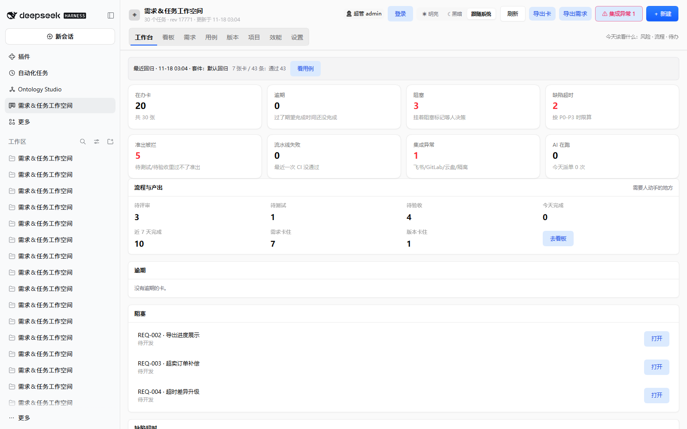 | 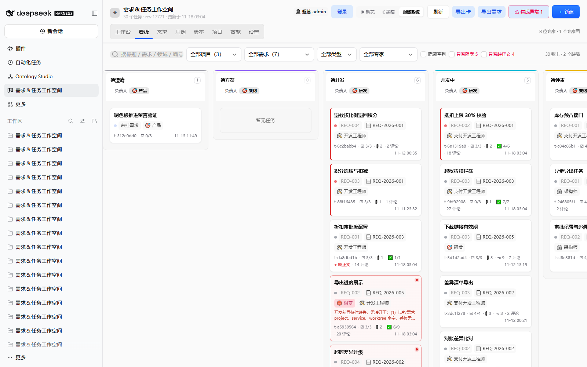 |

| 卡片抽屉：状态 / 清单 / 用例 / 执行记录 | 需求：基线、变更影响面、可追溯矩阵 |
| --- | --- |
| 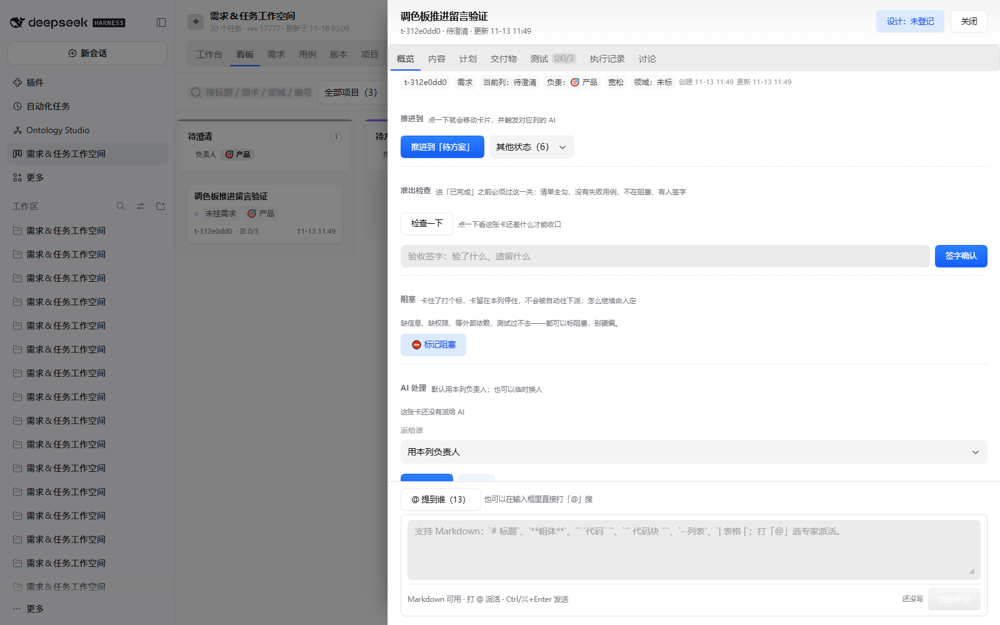 | 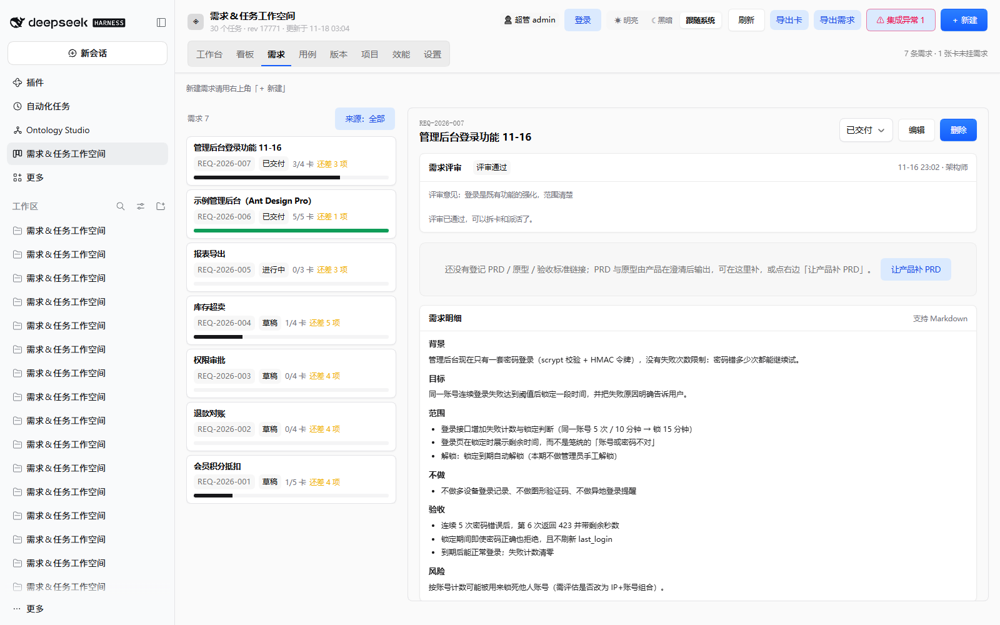 |
| 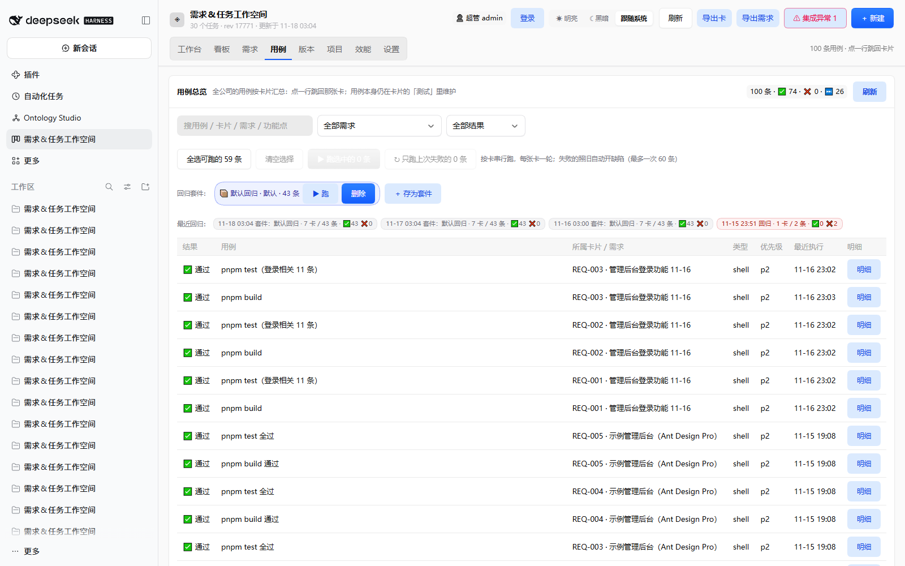 | 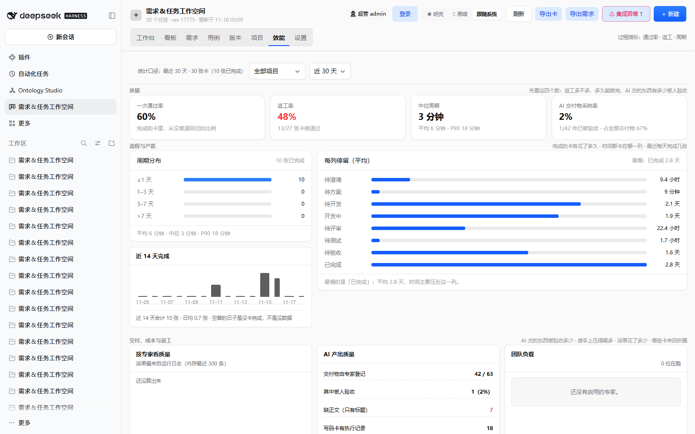 |

| 用例库：跨卡聚合、套件、最近回归 | 效能：一次通过率、返工率、按专家 + token 成本 |
| --- | --- |
|  |  |

| 版本：发布、灰度、部署记录 | 设置·测试执行：执行开关、数量上限、出站 webhook |
| --- | --- |
| 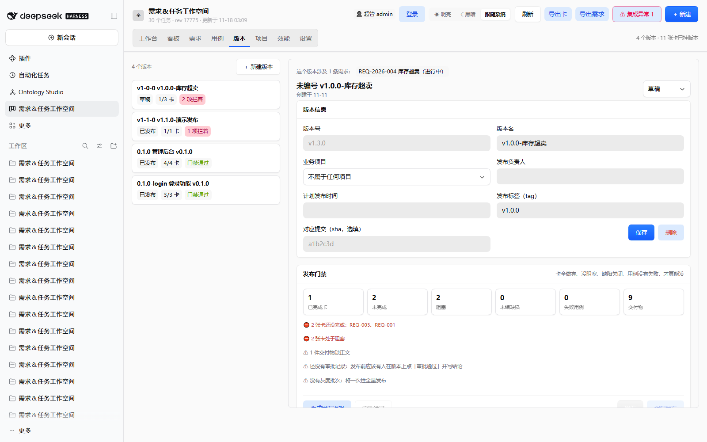 | 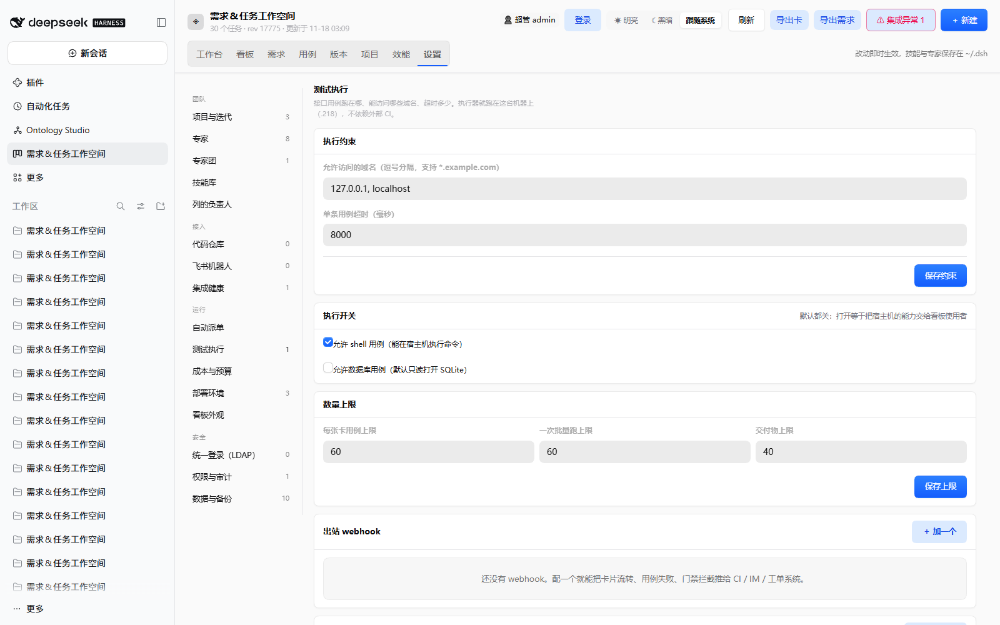 |

| 设置·成本与预算：价目表（元/百万 token） | 设置·专家：8 位专家、模型与提示词 |
| --- | --- |
| 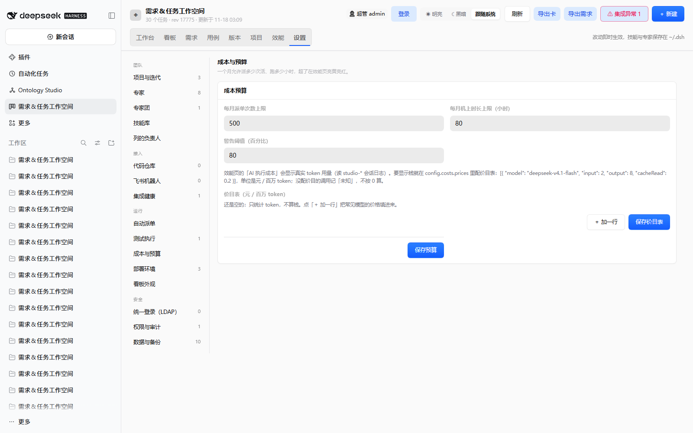 | 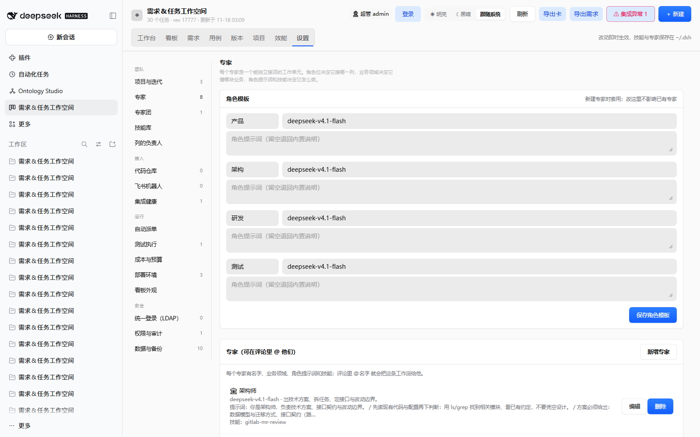 |

截图不是手截的：`npm run shots`（`tools/visual/capture.mjs`）会登录面板、逐个页签截一遍，顺手断言没有「渲染失败」。

## 安装

两种装法，任选一种。**装的是 npm 上的发布版**（带构建好的 `client.js`，不需要本地构建）。

### 方式一：从 npm 装（推荐）

```bash
# 全局级安装进当前 DSH profile 的插件目录
dsh plugin --profile web install @ding-6/dsh-ontology

# 或者用 npm 直接装进 profile
npm install --prefix ~/.dsh/profiles/web @ding-6/dsh-ontology

# 确认挂载 + 重启
dsh --profile web --dump-config | grep -A2 'dsh-ontology'
sudo systemctl restart dsh-web
```

升级到新版本：

```bash
dsh plugin --profile web install @ding-6/dsh-ontology@latest
sudo systemctl restart dsh-web
```

### 方式二：从源码装（要改代码时）

```bash
git clone https://github.com/Ding-6/dsh-ontology.git ~/dsh-ontology
cd ~/dsh-ontology && pnpm install && pnpm --dir web run build   # 改过 web/src 才需要构建

# 装进目标 profile（写 profile 的 package.json + bundles，走 pnpm link）
dsh plugin --profile web add link:~/dsh-ontology

dsh --profile web --dump-config | grep -A2 'dsh-ontology'
sudo systemctl restart dsh-web
```

### 验证装好了

浏览器打开 DSH Web，左侧栏出现「本体建模工作空间」；或直接打接口：

```bash
curl -s http://<host>:<port>/ontology-api/state | head -c 80   # 应返回 {"ok":true,"revision":...}
```

## 安全与来源边界

默认**不启用登录**（`access.enabled=false`），开箱即用。这个模式下有三类操作只允许在
**服务器本机（127.0.0.1）**执行，其他机器调用会返回 `403 local_only`：

| 限制的操作 | 为什么 |
| --- | --- |
| 插件安装 / 卸载（市场） | 装的是任意 npm 包，含 install 脚本 = 宿主 RCE |
| 快照恢复 | 一次覆盖整个数据库，不可撤销 |
| 审计 / 派单日志导出 | 内容是操作人姓名与操作路径 |

其余管理操作（角色模板、项目、集成、成员权限）与全部业务读写不受影响。要在局域网里做上面三件事，
先到「设置 → 权限与审计」开启登录。

另外两条与安全有关的默认值：

- **需求里的外部链接只接受 http(s) / mailto / 站内路径**，`javascript:` 一律被丢弃（防存储型 XSS）。
- **更换 LDAP 服务器地址必须重新输入服务端账号口令**，不会拿已保存的口令去连新地址。

## 发版

打 tag 即自动发版，不需要任何令牌：

```bash
npm version 0.5.0 --no-git-tag-version
cd web && pnpm run build && cd .. && npm test
git commit -am "chore(release): v0.5.0"
git tag -a v0.5.0 -m "v0.5.0" && git push && git push origin v0.5.0
```

GitHub Actions（`.github/workflows/release.yml`）会依次：校验 tag 与 `package.json` 一致 →
语法 → 契约测试 → 构建 → 产物可复现 → 用 **Trusted Publishing(OIDC)** 发布到 npm（带 provenance，
不依赖长期令牌）→ 等 registry 出现该版本 → 正式版再核对 `npm latest`。

## 质量闸门

两类 HTML/CSS 抓不到的回归，现在由构建期守卫和真库自检挡住：

| 命令 | 挡什么 |
| --- | --- |
| `cd web && npm run guard` | CSS 里写回 `hsl(var(--x))`（颜色解析失败）、Radix Portal 忘记 `container={portalRoot()}`（弹层「存在但不可见」）、产物丢失门户作用域属性 |
| `npm run smoke:store -- ~/.dsh/dsh-ontology.db` | 用生产库的 `.db/-wal/-shm` 副本在本地跑真实启动路径，抓「空库能起、真库就炸」的 `ReferenceError` |
| `npm run release:check` | 发版前文档自检：CHANGELOG 有本版条目、compatibility 版本号一致、README 提到的脚本都存在；**改了代码却没改 README 会直接红** |
| `npm test` | **124 条**契约：manifest、产物哈希、宿主接口、跨模块导入、只读绑定赋值、迁移与文档一致性、门禁纯函数、快捷键解析 |

真机验收（需要 `ONTOLOGY_TOKEN`，对着测试机跑，非零即红）：

| 命令 | 覆盖 |
| --- | --- |
| `npm run verify:pages` | 8 个页面（含语义层）能进、能渲染、页签高亮、无 pageerror（25 项） |
| `npm run verify:ontology` | **语义层端到端**（33 项）：空台账起步 → 人工登记 AI 草稿 → 专家校准为「已确认」并留结论 → 缺口与闸门跟服务端对账 → 多本体 / 建模建议 / 领域骨架生成骨架 → 应用蓝图三章 → 存入手册并检索命中 → 载入内置手册书（86 章节）并检索命中 → MCP 封装 → 探针数据自清理 |
| `npm run verify:audit` | **27 个模块**（8 页签 + 16 设置面板 + 3 抽屉）里还有没有原生下拉/原生输入/老按钮（违规必须为 0） |
| `npm run verify:selects` | 下拉是否都是官方组件、尺寸是否合规范、弹层是否真的在最上层 |
| `npm run verify:drawer` | 抽屉打开/聚焦/Esc/取消（15 项） |
| `npm run verify:drawertabs` | 卡片抽屉里 7 个内层页签 |
| `npm run verify:auditlog` | 审计日志是官方 Table + 每页 50 行 + 翻页生效（7 项） |
| `npm run verify:toast` | toast 真的出现在门户容器里、有尺寸、4 秒后消失（7 项） |
| `npm run review:layout` | 24 个模块的字号/溢出/内联硬编码颜色巡检 |
| `npm run review:components` | 官方元素 vs 自研元素的分布，看还有哪些组件没换 |

`pnpm build` 已串上守卫（`make-legacy → guard --pre → vite build → sync-client → guard --post`），CI 也会跑：忘记构建或写出上面两类样式，流水线直接红。

## 门禁链（从澄清到发布）

平台不是「拖过去就算完」：每一步都有东西看着，**拦的只有必须在场的东西，其余一律只提示**——提示多了会被无视，拦多了会被绕过。

| 阶段 | 检查 | 拦不拦 |
| --- | --- | --- |
| 澄清 | 三问必答（有没有服务端 / 鉴权谁做 / 交付边界） | **拦**：答不完拆不了卡 |
| 拆卡 | 说有后端，但功能点没有一条讲接口 / 数据表 / 鉴权 | 提示 |
| 拆卡 | 说没有后端，功能点却要建表 / 写接口 | 提示 |
| 拆卡 | 功能点没有验收标准（长不出用例） | 提示 |
| 卡准出 | 清单没勾完 / 有用例失败 / 卡被标阻塞 / 没人签字 | **拦**（`override` 可强推，须写原因并留痕） |
| 需求准出 | 没有产品输出 / 评审没过 / 有待确认问题 / 卡没完成 / 卡在阻塞 / 缺陷未关 / 用例失败 / **一条跑过的用例都没有** / 没签字 | **拦** |
| 需求准出 | **卡上没有产品/架构专家的讨论**（只有自动跑用例的汇总）、RICE 没打分、功能点没被通过用例覆盖、**有用例没跑过**、**有用例被标跳过**、**「通过」是手标的没有执行记录**、**有卡是强推的**、没有交付物 | 提示 |
| 发布 | tag 名、关联卡、冒烟清单 | **拦** |

> 需求签字前会先算准出门禁；确实要提前签就传 `override` 写一句原因，原因会出现在需求准出里——**逃生舱可以开，但要留痕**。
> 新加一条门禁或一条体检，必须同时进 `npm run selfcheck`（连跑三轮的闭环断言），否则它只是写在代码里的建议。

## 更多文档

| 想了解 | 看这里 |
| --- | --- |
| 登录与免登录（LDAP / 本地超管 / 会话落库） | [docs/auth.md](docs/auth.md) |
| 界面实现（shadcn 对齐 / 构建链 / 布局一致性 / 暗色巡检） | [docs/ui.md](docs/ui.md) |
| 第一天上手（三条命令，全新 clone 验过） | [docs/quickstart.md](docs/quickstart.md) |
| 发版到插件市场 | [docs/publish.md](docs/publish.md) |
| 宿主接口依赖与升级 runbook | [docs/compatibility.md](docs/compatibility.md) |
| **本体开发指南**（从业务分析到蓝图的完整用法） | [docs/ontology-guide.md](docs/ontology-guide.md) |
| **操作手册**（面板怎么用：页签、语义层、看板流程、API 速查、数据备份与清空） | [docs/manual.md](docs/manual.md) |
| 过程记录（按日期的实现流水账） | [docs/history.md](docs/history.md) |
| 每个版本改了什么 | [CHANGELOG.md](CHANGELOG.md) |

## 开发与兼容性

- 参与开发（构建链、部署、验证要求、禁区）：[AGENTS.md](AGENTS.md)
更新日志（每版改了什么、有哪些已知限制）：[CHANGELOG.md](CHANGELOG.md)
上手第一天（三条命令，已在全新 clone 上验证过）：[docs/quickstart.md](docs/quickstart.md)
发布到插件市场（npm / GitHub 发版 + 收录条目 + 自查清单）：[docs/publish.md](docs/publish.md)
- 依赖的 dsh 宿主接口、升级 runbook、兼容矩阵与已知限制：[docs/compatibility.md](docs/compatibility.md)
- 本机（Windows 桌面宿主）改了代码怎么让它生效：`npm run sync:live`（宿主按真实文件 URL 缓存 ESM 模块，换路径才重新 import；细节见 [AGENTS.md](AGENTS.md) §3.1）

## 已知限制

- 上下文**构成占比**（工具 / 助手 / 输入）是按会话日志文本体积估算的，不是引擎账目：宿主把 `sessionProjections` 暴露给了插件，`tokenMeasurement` 就是引擎计量，但 `stateOf()` 要**活会话对象**，只能在派单收尾时取——还没接（调研结论见 `docs/history.md`）。**占用率已经是真实数据**（用 `request/context` 的 `contextWindow`）。
- 多维表格镜像是**手动触发**的（`POST /ontology-api/feishu/mirror`，支持 `dryRun` 先看会写多少条）：一条记录 = 一张卡，200 条一批串行写；表里要有「编号 / 标题 / 状态 / 负责人 / 优先级 / 需求 / 更新时间」这几列。**还没在真实表格上验证成功路径**——本机 lark-cli 未完成用户授权时，它会如实返回 authorization 错误而不是假成功。
- GitLab 同步 Issue 与**关联 MR**（`/issues/:iid/related_merge_requests`）；卡上挂 MR 后「从 GitLab 核对」会拉 MR 详情、`/changes` 与 `/pipelines`（流水线状态进 `coding.gitlab`）。**不同步 MR 的评论**；MR 的合并/关闭状态要等下一次同步才反映到卡上。
- 用例记录存在卡上（`task.cases`）：跨卡的**用例总览**页签可以勾选批量跑（结果回写各自卡、失败照旧开缺陷），也支持**回归套件**（`/suite/*`：按规则或手选固定一批，一键重跑，`by` 记「套件：名字」）。但还没有「回归套件」这个对象——固定的用例集合、一键重跑、历次通过率趋势都还没有，批量跑是临时勾选、跑完即散。
- 缺陷卡的严重级别默认 `P2`、优先级 `normal`：自动建卡不猜严重程度，由人或在评论里改。
- 派单失败会记在 `/ontology-api/integrations` 与卡片抽屉里，并按 `agentRetryPlan` **自动重试**（间隔递增、有上限）；超过上限才挂阻塞等人。
- 集成健康现在会**落盘保留最近一次结果**（SQLite 的 `meta:side:integration-health`，不进 state、不涨 revision、不占快照）：重启 dsh-web 后四条通道不再回到「还没用过」。仍然只是「最近一次」，没有按小时/按天的长期趋势（要趋势还得上采集）。
- 工具层权限只认会话名（`ontology-<taskId>-<expertId>`）：如果哪个 agent 用了别的会话名，就会被当成「名单外」拦下写操作，需要在审计里看一眼。
- 同一张卡在同一列只自动派一次（防止来回循环），需要再跑一轮就点「马上处理」，或在评论里 `@` 它。
- 并发上限是全局的（设置 → 自动派单 → 同时最多几个 agent，默认 2）：名额满了新卡就排队，把在跑的会话停掉或把上限调大即可。
- 删掉卡片会自动收回它占用的名额（原来会留一个幽灵会话把并发名额占死，已修）。
- 专家团是「团长 + @ 接棒」的协作模式；2026-11-13 起有**团级记忆**：卡推进到「完成」时自动记一条（做了什么、遗留什么），派活时把这个团最近 5 条塞进专家提示词；0.1.24 起**同一条经验出现 ≥2 次会提炼成「这次先规避」的约束**（记忆里反复踩的坑才会变成硬提示），避免同一批人反复踩同一个坑。记忆存在 SQLite 的 side 键里，最多每个团 20 条，可在「设置 → 专家团」里清空。
- 新写或改写的技能对**已经开着的会话**不立即生效（技能目录在会话开始时枚举），开新会话或下一次派单即可看到。
- 「从链接拉飞书正文」与「产物归档到飞书云盘」都依赖宿主机的 `lark-cli` 与有效的用户授权；`auth status` 里 user 不是 ready 时页面会提示，按提示重新授权即可。
- 归档出来的是云盘里的 Markdown 文件，不是飞书在线文档：同事能打开、能下载、能被搜索，但不能在线协同编辑与评论；正文由平台覆盖更新，人工在飞书上改的内容下次覆盖会丢。
- 归档是同步写：一次要写很多产物时（比如批量补历史）会挨个调 `lark-cli`，几十份文档需要十几秒到几十秒。
- 需求基线是快照：可以**逐行对比**「基线 vs 最新 PRD」（只读，`web/src/studio/diff.js` 的 LCS），也**可以回滚到基线**——
  回滚是实质变更：正文回到基线那一版、文档版本号 +1、原来的验收签字作废，并在文档历史里留一条「PRD 回滚」（谁回滚的、从哪一版）。
  「设为基线 / 对比基线 / 回滚到基线 / 取消基线」四个入口都在需求详情的「文档与基线」里；需求的评审仍是人工点按钮，没有独立审批流。
- 「从链接拉正文」支持飞书的 docx / wiki 链接（走宿主机 `lark-cli docs +fetch`，飞书云盘的 `file/` 链接会明确被拒）；
  拉回来的正文可以直接设为基线。这一步 2026-11-17 在一篇真实 wiki 文档上验过（标题与 1715 字正文都拿到了）。
- AI Coding 执行记录由 agent/人登记；卡上挂了 MR 后「从 GitLab 核对」（`/coding/gitlab`）会拉 MR 详情、`/changes`（改动文件清单 + 提交数）、
  `/commits`（逐条提交）与流水线做事实比对：**自报的每个提交都要按 sha 前缀在 MR 里找得到**，对不上的单独列在抽屉里，不静默覆盖。
  流水线有测试报告时（`/pipelines/:id/test_report`）还会比自报的单测数；仓库没产出报告就退一步数 job 成败（那是任务数，不跟单测数比）。
  仍缺：CI 产物本身（构建物、报告文件）不下载，只记数字；真实 `git.lyf.com` 令牌还没接通，这条链目前用 `tools/mock-gitlab.mjs` 打桩验过。
- 「业务负责人」与「期望完成」是可选项：没填时抽屉里显示「未指派」/「未排期」，不是数据丢失；需要时补上再点「保存改动」。

## 许可证

Apache-2.0，见 [LICENSE](LICENSE)。仓库里不含公司数据，配置示例里的地址 / token / 主机名都是占位值。

